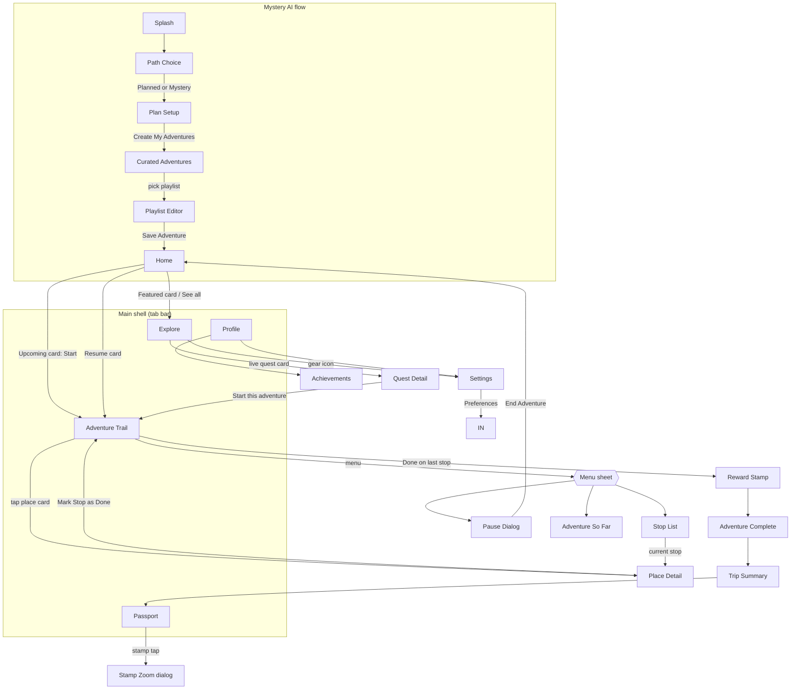

# Mystery City Adventures — Screen Guide

Every screen in the app, what it contains, and how users flow between
them. **Use the bold screen names below when giving change commands**
(e.g. "on the **Adventure Trail**, make the cards bigger" or "replace
the **Quiz** section of **Place Detail** with X").

Routes come from `app/lib/navigation/router.dart`. Files live in
`app/lib/screens/`.

---

## 1. Mystery AI flow (current entry flow — branch `mystery-ai`)

Status: **skeleton** = structure + navigation + working dummy data,
final design pending its slice.

| # | Screen name | Route | File | Status |
|---|---|---|---|---|
| 1 | **Splash** | `/splash` | `onboarding/splash_screen.dart` | final |
| 2 | **Path Choice** | `/path-choice` | `plan/path_choice_screen.dart` | skeleton |
| 3 | **Plan Setup** | `/plan` | `plan/plan_setup_screen.dart` | skeleton |
| 4 | **Curated Adventures** | `/curated` | `plan/curated_adventures_screen.dart` | skeleton |
| 5 | **Playlist Editor** | `/playlist` | `plan/playlist_editor_screen.dart` | skeleton |

**Splash** — App title + tagline over a sky gradient; mascot street
scene at the bottom. *Get Started* → **Path Choice**.

**Path Choice** — Mascot greeting + "Choose Your Path": two big cards —
**Planned Exploration** (everything visible, curate your day) and
**Mystery Exploration** (places hidden; teasers + distance radii until
you arrive). Choice sets `ExplorationMode` for the whole flow →
**Plan Setup**.

**Plan Setup** — One scrollable form: free-text **city** field (US
cities), **date** picker (shows day name), **start time** picker; "What
would you love to explore?" — **12 categories** (Food & Drinks, Nature &
Parks, Art & Culture, Scenic & Photography, Shopping & Markets, Social &
Family, Bars & Nightlife, Adventures & Outdoors, Entertainment, Wellness
& Relaxation, Hidden Gems & Mystery, Experiences & Learning), max **5**
selectable (counter, 6th tap bounces with toast); free-text **wish box**
("a nice park and good coffee for a lazy Sunday…"). CTA *Create My
Adventures* (enabled when city+date+time+≥1 category) → **Curated
Adventures**.

**Curated Adventures** — "Your Curated Adventures" (echoes the wish
text); 4–5 playlist cards from the dummy recommendation engine
(`PlanFixtures.recommendPlaylists` — scores 6 fixture playlists by
category overlap): hero art, title, tagline, stops/duration chip,
category chips, stop-name preview (masked teasers in Mystery mode).
Tap a card → **Playlist Editor**.

**Playlist Editor** — The chosen playlist as an editable list: drag
handle to reorder, ✕ to remove (blocked at 1 stop with toast). Planned
mode rows: photo, place name, category, time. Mystery mode rows: ?
placeholder, teaser title ("A café hiding under a living green roof"),
**~distance in miles**, time. *Save Adventure* → saves (single
`SavedAdventure`) → **Home**, which now shows an **Upcoming Adventure
card** ("Opens Sat, 10/25" — demo rule: starting is always allowed) →
tap → resets progress → **Adventure Trail**.

Data models: `app/lib/data/plan_models.dart` (ExplorationMode,
AdventureCategory, PlanRequest, PlaylistItem wraps Place, …);
fixtures + engine: `app/lib/data/plan_fixtures.dart`.

---

## 2. Main shell — 5 tabs

`screens/shell/app_shell.dart` renders the bottom tab bar
(Home · Explore · Adventure · Passport · Profile). The bar auto-hides on
**Quest Detail**, **Settings**, and **Achievements**.

| Tab | Screen name | Route | File |
|---|---|---|---|
| 1 | **Home** | `/home` | `home/home_screen.dart` |
| 2 | **Explore** | `/explore` | `explore/explore_screen.dart` |
| 3 | **Adventure Trail** | `/adventure` | `adventure/adventure_path_screen.dart` |
| 4 | **Passport** | `/passport` | `passport/passport_screen.dart` |
| 5 | **Profile** | `/profile` | `profile/profile_screen.dart` |

**Home** — "Good morning, Explorer!" over the hero scene (baked speech
bubble in the art); **Resume Adventure card** (dark pill: active
adventure name, progress bar, play button) → **Adventure Trail**;
"Featured Adventures" header with *See all* → **Explore**; two featured
cards (The Foodie Trail, Art & Soul) with image, icon badge, blurb, tag
chips, and heart toggle → tap opens **Quest Detail**.

**Explore** — Mascot speech bubble + settings shortcut (→ **Settings**);
floating hero banner; title + subtitle; filter chips
(All/Popular/Food/Culture/Nightlife) that re-flow the grid; 2-column
grid of 8 quest art cards. 4 are live (Peaceful Retreat, Night Party
Quest, Artistic Quest, Real Stories Quest) → **Quest Detail**; 4 show a
"coming soon" toast (Foodie Adventure, Family Fun, Couples Escape,
Local Secrets).

**Quest Detail** (`/explore/quest/:id`, `explore/quest_detail_screen.dart`)
— ONE parameterized screen reskinned per quest theme (accent color:
green/purple/orange/red). Ken Burns hero with frosted back + heart
buttons; icon badge + title + description; tag chips; 3-item meta row
(duration/stops, route, audience); "What to expect" 4-thumb strip;
"Sample stops" numbered timeline with dashed accent line; *Start this
adventure* → resets progress → **Adventure Trail**.

**Adventure Trail** — the centerpiece (see §3).

**Passport** — "My Passport" title; Stamps/Cities segmented pills.
Stamps tab: 3-column grid — 5 earned stamps in colored frames
(Amsterdam, Paris, London, Barcelona, Tokyo) + 1 dashed "Coming Soon"
placeholder (New York); tap an earned stamp → zoom dialog; mascot
"Keep exploring" footer card. Cities tab: 2-column city photo grid.

**Profile** — "My Explorer Profile"; avatar + name (Alex) + "4
Adventures Completed"; animated XP bar (Level 4, 65%); stats card
(12 Locations · 8 Stamps · 5 Cities, count-up); menu rows: *My
Adventures* → **Adventure Trail**, *Saved Places* (toast stub),
*Achievements* → **Achievements**, *Settings* → **Settings**.

**Settings** (`/profile/settings`, `profile/settings_screen.dart`) —
Grouped rows: Edit Profile (stub toast), Preferences → **Interests**,
Notifications (stub), Help & Support (stub), About (stub). "Experience"
group with WORKING controls: Sound effects toggle, Haptics toggle,
Reduce motion toggle, Theme switcher (Navy/Warm — live app-wide
re-theme). Log Out row swaps inline to a red confirm (stub). Footer
illustration.

**Achievements** (`/profile/achievements`, `profile/achievements_screen.dart`)
— Back → Profile; "6/20 unlocked" + green progress bar that fills on
entry; 5 medal rows (First Adventure unlocked ✓; Foodie Explorer,
Culture Seeker, Stamp Collector, City Hopper locked — dimmed with
padlock, shake on tap).

---

## 3. The Adventure Trail + its flow (current main gameplay)

**Adventure Trail** (`/adventure`) — One long scrollable illustrated
scene (~2.6 screens tall) for the active adventure (fixture: Peaceful
Retreat, Amsterdam). Contents top→bottom:

- **Header** (pinned): back → **Home**, adventure title + "Amsterdam ·
  3–4 hours", menu button → bottom sheet (*Pause adventure* →
  **Pause Dialog**, *All stops* → **Stop List**, *Adventure summary* →
  **Adventure So Far**)
- **Welcome block**: mascot sticker + speech bubble + "4 stops · Nearby
  & walk-friendly" sign chip
- Painted scenery: morning sky + bridge → park greens → golden band
  with houses → misty pines; clouds drift, trees sway, fog breathes,
  layers parallax with scroll
- **Winding route** with 4 stop nodes (done = green check, current =
  pulsing gold number, upcoming = soft green number) — the route is
  tinted green up to the current stop
- **4 small place cards** beside the nodes: thumb, name, category,
  ★ rating (count), time chip, one-line specialty. The CURRENT card
  also has a green *Done* button + *Details* link
- Mascot (walking) stands beside the current node
- **Finish badge** ("Your stamp") and an end message

**Place Detail** (`/stop/:index`, `adventure/place_detail_screen.dart`)
— Fullscreen expansion of a place card: Ken Burns hero + time chip +
back; name/category + "Visited" chip when done; rating card (4.8 ★★★★½,
"2,314 Google reviews", popularity line); description; highlights strip
("Top rated items" with prices for the café / "Don't miss" elsewhere);
green **offer ticket** (when present); 2 review cards (avatar, name,
stars, quote); "Did you know?" fun-fact card; **Mini Quiz** (optional,
4 options, green/red feedback + fact reveal). Sticky CTA depends on
stop state: *Mark Stop as Done* (current) / *Visited ✓* (done) / *Up
next — finish earlier stops first* (future).

### Done ceremony (the core loop)

Tapping *Done* (on the trail card or in Place Detail):
confetti + success sound → the route segment to the next stop animates
green with a traveling glow dot (~1.4s) → screen auto-scrolls to the
next stop → mascot + pulse move there. On the LAST stop: fanfare →
**Reward Stamp**.

### Completion chain (after stop 4)

| Screen name | Route | Contents |
|---|---|---|
| **Reward Stamp** | `/chapter/stamp` | "You Earned a Stamp!", polaroid photo + red stamp seal slamming in with thud/haptic, adventure name + city + quote. *Continue* → **Adventure Complete**; *View My Passport* link → **Passport** |
| **Adventure Complete** | `/journey/complete` | Confetti over hero art, "Adventure Complete!", 4 stat tiles counting up (Chapters/Locations/Stories/Stamp), mascot "Amazing job!" card. *View My Adventure* → **Trip Summary** |
| **Trip Summary** | `/journey/trip` | Hero + adventure info card (name, city, date, chapters), "Places You Explored" list (tap → fact toast), horizontal "Moments" photo strip. *Save to My Passport* → **Passport** |

### Trail side screens

| Screen name | Route | Contents |
|---|---|---|
| **Stop List** ("Your Journey Continues") | `/journey/chapters` | Vertical timeline of all 4 stops: done (green check + name), current (gold number, tap → **Place Detail**), locked (grey cloud thumb, "Complete chapter N to unlock", shake on tap) |
| **Adventure So Far** | `/journey/summary` | Tabs: Locations (numbered list, locked rows greyed "To be discovered"), Photos (grid of completed-stop photos), Stories (fact cards). Mascot "Keep exploring!" footer with remaining-stop count |
| **Pause Dialog** | modal over trail | Resting mascot, "Take a Break?". Buttons: *Pause Adventure* (toast + close), *End Adventure* → inline red confirm ("Yes, End" resets progress → **Home**), *Keep Exploring* (close) |

---

## 4. Legacy screens (OFF the main path)

Kept in the codebase, reachable only by direct route — candidates to
modify, repurpose or delete:

**Retired onboarding** (replaced by the Mystery AI flow):

| Screen name | Route | What it was |
|---|---|---|
| **Welcome** | `/welcome` | Greeting page (dropped by decision) |
| **Interests** | `/interests` | 6-tile interest picker (superseded by the 12 categories; still linked from Settings → Preferences) |
| **City Picker** | `/city` | 6-city photo grid (superseded by the city text field) |
| **Mystery Mode** | `/mode` | Full/Balanced/Open selector (superseded by Path Choice) |
| **Customize** | `/customize` | Classic/Challenging/Relaxed + travel style |
| **Adventure Preview** | `/preview` | Drifting journey map |

**Old chapter flow:**

| Screen name | Route | What it was |
|---|---|---|
| **Chapter Start** | `/chapter/start` | "Chapter N" intro: scene art + rising "Your Clue" card, *Let's Solve It!* → **Solving Clue** |
| **Solving Clue** | `/chapter/clue` | "Look Around" spot-the-detail: scene image + 3 option thumbs; wrong = shake, right → **Location Reveal** |
| **Location Reveal** | `/chapter/reveal` | Confetti "You Found It!", celebrating mascot, venue card → **Reward Stamp** |
| **Chapter Quiz** | `/chapter/quiz` | Old quiz screen (quiz now lives inside **Place Detail**) — currently orphaned, nothing links to it |
| **Chapter Complete** | `/chapter/complete` | "Chapter N Complete!": star coin drop, checklist ticking in, *Next Chapter* |

---

## 5. Full user workflow (one picture)

Plain-English journey: **Splash → Path Choice (Planned/Mystery) → Plan
Setup (city, date, time, up to 5 categories, wish text) → Curated
Adventures → Playlist Editor (reorder/remove, save) → Home upcoming
card → Adventure Trail.** On the trail the loop is
*open place card → read details / play quiz → Mark Done → route travels
to next stop*, four times. Finishing the last stop triggers **Reward
Stamp → Adventure Complete → Trip Summary → Passport**. At any time the
tabs give Home (resume), Explore (browse/start other quests — currently
all start the same fixture trail), Passport (collection), Profile
(settings, achievements, theme/sound toggles).

---

## 6. Current limitations (so commands are precise)

- "Entry + data" is a single fixture: starting ANY quest runs the
  Peaceful Retreat trail with the same 4 places
  (`app/lib/data/fixtures.dart` → `places`, `chapters`).
- Mystery Mode / Customize choices are stored but don't change gameplay.
- Stubs that only toast: Saved Places, Edit Profile, Notifications,
  Help & Support, Log Out, Pause.
- All art/sounds are placeholders; mascot is a static sticker awaiting
  the Rive rig (swap point: `widgets/mascot.dart`).
