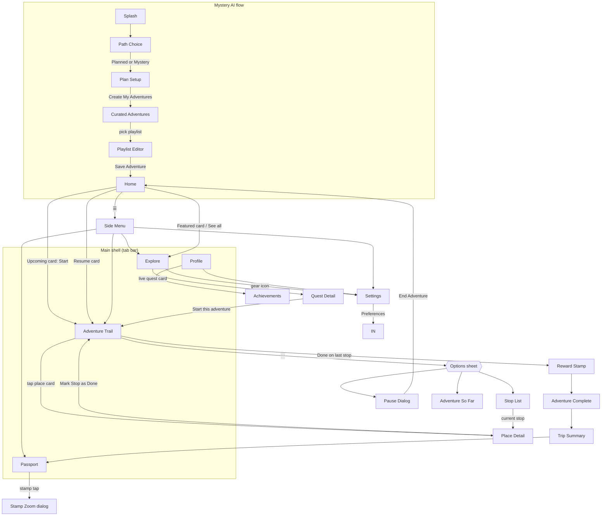

# Mystery City Adventures — Screen Guide

Every screen in the app, what it contains, and how users flow between
them. **Use the bold screen names below when giving change commands**
(e.g. "on the **Adventure Trail**, make the cards bigger" or "replace
the **Quiz** section of **Place Detail** with X").

Routes come from `app/lib/navigation/router.dart`. Files live in
`app/lib/screens/`.

---

## 1. Mystery AI flow (current entry flow — branch `mystery-ai`)

Status: **skeleton** = structure + navigation + working dummy data,
final design pending its slice.

| # | Screen name | Route | File | Status |
|---|---|---|---|---|
| 1 | **Splash** | `/splash` | `onboarding/splash_screen.dart` | final |
| 2 | **Path Choice** | `/path-choice` | `plan/path_choice_screen.dart` | skeleton |
| 3 | **Plan Setup** ("Mood Builder") | `/plan` | `plan/plan_setup_screen.dart` | designed (design1001) |
| 4 | **Curated Adventures** | `/curated` | `plan/curated_adventures_screen.dart` | skeleton |
| 5 | **Playlist Editor** ("Your Itinerary") | `/playlist` | `plan/playlist_editor_screen.dart` | designed (design1001) |

**Splash** — App title + tagline over a sky gradient; mascot street
scene at the bottom. *Get Started* → **Path Choice**.

**Path Choice** — Mascot greeting + "Choose Your Path": two big cards —
**Planned Exploration** (everything visible, curate your day) and
**Mystery Exploration** (places hidden; teasers + distance radii until
you arrive). Choice sets `ExplorationMode` for the whole flow →
**Plan Setup**.

**Plan Setup ("Plan Your Day")** — layout per
`design/mockups/02_plan_setup.png` (user decision 2026-10-19; the
design1001 Mood Builder layout was superseded, its interactions kept).
Header: back + "Plan Your Day" + mode caption (🔮 Mystery / 🗺️ Planned).
One scrollable form:
- "Where & when" — full-width **city** field (bottom sheet: free text +
  popular US city chips) above a **date + time** row (native pickers)
- "What would you love to explore?" + green **n/5** pill (pops on
  change, turns gold at 5) — the **12 categories as emoji chip Wrap**
  (selected = filled green); 6th pick bounces with a friendly toast
- **Cap note** under the chips: "✨ Nice mix! N more picks and your day
  is full." → at 5/5 flips gold "🎉 All 5 picked — sounds like a great
  day!" (pop + success sound, once)
- "Anything specific in mind?" — **wish textbox**
- **Companion bubble** (interactions #6): mascot types (bouncing dots),
  then reacts to picks/mood; celebrates at 5 picks
- CTA **Create My Adventures ✨** — BouncyPressable (interactions #1);
  enabled when city+date+time+≥1 category → **Curated Adventures**.
(The mood field remains in `PlanRequest` but has no UI on this layout.)

**Curated Adventures** — "Your Curated Adventures" (echoes the wish
text); 4–5 playlist cards from the dummy recommendation engine
(`PlanFixtures.recommendPlaylists` — scores 6 fixture playlists by
category overlap): hero art, title, tagline, stops/duration chip,
category chips, stop-name preview (masked teasers in Mystery mode).
Tap a card → **Playlist Editor**.

**Playlist Editor ("Your Itinerary")** — designed to
`design/design1001/list of adventure places.png`. Postal theme:
- Header: playlist title + "🔮 Mystery mode · Sun, Oct 25 · 10:00 AM",
  faint rotated **airmail postmark** (✈️) decoration
- Rotated **"Your Itinerary" tape label** (handwritten Caveat font) +
  "Drag ⠿ to reorder" hint
- Each stop is a **pastel ticket** (rotating green/gold/blue/pink
  tints) with: colored rail number + dashed connector, **perforated
  postage-stamp thumbnail** (place photo in Planned mode, spoiler-safe
  emoji in Mystery), teaser/place title, time + "~x mi" pill, a
  star-edged **"+N pts" points seal**, and ✕ remove (min 1 stop)
- **Drag wobble + snap** (interactions #5): the lifted ticket wobbles
  continuously (±1.3°, scale 1.04, deep shadow) and snaps with a pop
- Summary card: celebrating mascot + "N stops / ~x mi total" +
  **stamp-points total** (counts up) + handwritten "Another day of good
  places awaits!"
- *Save Adventure 🎒* (BouncyPressable) → **Lottie confetti burst** +
  fanfare → saves → **Home** shows the **Upcoming Adventure card**
  ("Opens Sat, 10/25"; demo rule: starting always allowed) → tap →
  **Adventure Trail**. Caption: "Opens Sunday, Oct 25 — we'll have
  everything ready."
Data: `PlaylistItem.points` + `.emoji` (per-stop stamp points feed the
summary total); Lottie asset at `app/assets/lottie/confetti.json`.

Data models: `app/lib/data/plan_models.dart` (ExplorationMode,
AdventureCategory, PlanRequest, PlaylistItem wraps Place, …);
fixtures + engine: `app/lib/data/plan_fixtures.dart`.

---

## 2. Main shell — 5 tabs

`screens/shell/app_shell.dart` renders the bottom tab bar
(Home · Explore · Adventure · Passport · Profile). The bar auto-hides on
**Quest Detail**, **Settings**, and **Achievements**.

**☰ = Side Menu, everywhere in the shell.** Every tab screen carries the
same ☰ button (`widgets/menu_button.dart`) at its top-left, opening the
**Side Menu**. ☰ means only that; screen-local option sheets use ⋯.

| Tab | Screen name | Route | File |
|---|---|---|---|
| 1 | **Home** | `/home` | `home/home_screen.dart` |
| 2 | **Explore** | `/explore` | `explore/explore_screen.dart` |
| 3 | **Adventure Trail** | `/adventure` | `adventure/adventure_path_screen.dart` |
| 4 | **Passport** | `/passport` | `passport/passport_screen.dart` |
| 5 | **Profile** | `/profile` | `profile/profile_screen.dart` |

**Home** — designed to `design/design1001/home.png` (its bottom tabs
ignored; the app shell's 5-tab bar stays). Top to bottom:
- **☰ Menu button** (top-left, over the sky) → **Side Menu**.
- **Miku's world** (finch1.PNG top-of-screen layout; motion from the
  design1001 screen recording) — a full-bleed **animated sky scene**
  behind the status bar: saturated blue sky, sun with breathing halo
  rings, a small cloud crossing the whole sky plus two big drifting
  clouds, layered **mountain ridges**, a deep-blue cumulus bank
  bottom-left, and a green foreground hill. **Miku** (the companion's
  name) lives on the hill — a `LiveMascot` that never stops moving
  (continuous bob + sway + a happy hop) — beside the **animated dialog
  bubble**: typing dots play, then the line fades in, rotating every
  ~7s (time-of-day greeting → stamp tip → quest nudge). The content
  column below rides up over the hill, Finch-style.
- **Hero adventure card** — the MOST RECENT saved adventure, big:
  animated circular **progress ring** ("n / 4 stops today", fills on
  entry), 📍 city, title, mode pill (🔮 purple / 🗺️ green), "N more
  places to discover ›", scenic art fading in from the right
  (text-free `sceneImage` per playlist). Tap → **Adventure Trail**
- **Adventure list** — later-dated adventures as compact cards (thumb,
  title, city, date, mode pill); seeded with 4 dummies (Golden Hour
  Wander Nov 2, Market Morning Feast Nov 9, Storybook Streets Nov 15,
  Neon Nights Out Nov 21). **New saves land on top as the hero.** More
  than 4 total → **"See all (N adventures)"** expands the list inline
- **Action cards** — Mystery Adventure (gold-highlighted → Mystery mode
  Plan Setup) and Plan My Day (→ Planned mode Plan Setup); floating
  emoji art, info pills, arrow buttons. (Streak bar and Rewards card
  removed 2026-10-20 by user request.)
- CTA **🧭 Start today's quest** (BouncyPressable) → resets progress →
  **Adventure Trail**.

**Side Menu** — `/menu`, `home/side_menu_screen.dart`, full screen over
the shell, slides in from the left; ‹ back returns to **Home**.
Designed to `design/design1001/side_menu1.PNG` + `side_menu2.PNG`
(Finch layout) re-coloured to our theme: cream ground, navy promo
cards with cream lip buttons, gold "Mystery PLUS" card, white tiles and
grouped rows. Contents are placeholders (user will refine). Top to bottom:
- **Explorer card** — "Explorer & Miku", explorer code (tap copies) + Miku.
- **Promo cards** — *Add the widget* (Add) and *Enable notifications*
  (Enable) → "arrives soon" toasts.
- **Tile grid (2×3)** — Adventures (→ Adventure Trail), Explore Quests
  (→ Explore), My Passport (→ Passport), Stamps & Rewards
  (→ Achievements), Plan My Day (→ Plan Setup), History (toast).
- **Mystery PLUS card** — *Try free* (toast).
- **Community** — Invite friends, Explore together (toasts).
- **Account** — Notifications (toast), Profile (→ Profile), App theme
  PLUS badge (→ Settings), Preferences (→ Settings), **Sound effects**
  toggle and **Calm mode** toggle (= reduce motion) — both live.
- **Subscription** — Mystery Plus "None", Restore purchase (toasts).
- **Support** — Settings (→ Settings), Help center (toast), About (toast).

**Explore** — full-bleed **animated city scene** at the top
(`explore/city_scene.dart`, the city sibling of Home's sky): golden-hour
sky with a low glowing sun, drifting clouds, birds flapping across, a
two-layer skyline whose windows twinkle, and a red suspension bridge
over a shimmering river with a little boat crossing. The speech bubble +
settings shortcut (→ **Settings**), with ☰ (→ **Side Menu**) left of
the bubble, ride on the scene (the old static
hero banner image was replaced by it). Then title + subtitle; filter chips
(All/Popular/Food/Culture/Nightlife) that re-flow the grid; 2-column
grid of 8 quest art cards. 4 are live (Peaceful Retreat, Night Party
Quest, Artistic Quest, Real Stories Quest) → **Quest Detail**; 4 show a
"coming soon" toast (Foodie Adventure, Family Fun, Couples Escape,
Local Secrets).

**Quest Detail** (`/explore/quest/:id`, `explore/quest_detail_screen.dart`)
— ONE parameterized screen reskinned per quest theme (accent color:
green/purple/orange/red). Header (248pt, height unchanged) with
frosted back + heart buttons. **Animated header scenes** roll out per
quest (`explore/scenes/`, picked by quest id; quests without one keep
the Ken Burns hero image; the Explore card art cross-fades into the
scene on open):
  - **Peaceful Retreat — "Morning by the lake"** ✅: dawn sky + rising
    sun with breathing halo, drifting clouds, layered green hills,
    swaying round trees, lake with sun-glint streaks and drifting
    ripples, a duck family (mallard + 3 ducklings) gliding across with
    V wakes, breathing mist, drifting leaves, swaying reeds/cattails,
    and a fish jump with expanding rings every ~8s.
  - Planned (ideas agreed, not built): Night Party (neon street),
    Artistic (self-painting canvas), Real Stories (sepia old town),
    Foodie (market morning), Family Fun (fair day).
 icon badge + title + description; tag chips; 3-item meta row
(duration/stops, route, audience); "What to expect" 4-thumb strip;
"Sample stops" numbered timeline with dashed accent line; *Start this
adventure* → resets progress → **Adventure Trail**.

**Adventure Trail** — the centerpiece (see §3).

**Passport** — ☰ (→ **Side Menu**) + "My Passport" title; Stamps/Cities segmented pills.
Stamps tab: 3-column grid — 5 earned stamps in colored frames
(Amsterdam, Paris, London, Barcelona, Tokyo) + 1 dashed "Coming Soon"
placeholder (New York); tap an earned stamp → zoom dialog; mascot
"Keep exploring" footer card. Cities tab: 2-column city photo grid.

**Profile** — ☰ (→ **Side Menu**) + "My Explorer Profile"; avatar + name (Alex) + "4
Adventures Completed"; animated XP bar (Level 4, 65%); stats card
(12 Locations · 8 Stamps · 5 Cities, count-up); menu rows: *My
Adventures* → **Adventure Trail**, *Saved Places* (toast stub),
*Achievements* → **Achievements**, *Settings* → **Settings**.

**Settings** (`/profile/settings`, `profile/settings_screen.dart`) —
Grouped rows: Edit Profile (stub toast), Preferences → **Interests**,
Notifications (stub), Help & Support (stub), About (stub). "Experience"
group with WORKING controls: Sound effects toggle, Haptics toggle,
Reduce motion toggle, Theme switcher (Navy/Warm — live app-wide
re-theme). Log Out row swaps inline to a red confirm (stub). Footer
illustration.

**Achievements** (`/profile/achievements`, `profile/achievements_screen.dart`)
— Back → Profile; "6/20 unlocked" + green progress bar that fills on
entry; 5 medal rows (First Adventure unlocked ✓; Foodie Explorer,
Culture Seeker, Stamp Collector, City Hopper locked — dimmed with
padlock, shake on tap).

---

## 3. The Adventure Trail + its flow (current main gameplay)

**Adventure Trail** (`/adventure`) — One long scrollable illustrated
scene (~2.6 screens tall) for the active adventure (fixture: Peaceful
Retreat, Amsterdam). Contents top→bottom:

- **Header** (pinned): ☰ → **Side Menu** (replaced the old back arrow;
  Home is in the tab bar), adventure title + "Amsterdam ·
  3–4 hours", ⋯ options button → bottom sheet (*Pause adventure* →
  **Pause Dialog**, *All stops* → **Stop List**, *Adventure summary* →
  **Adventure So Far**)
- **Welcome block**: mascot sticker + speech bubble + "4 stops · Nearby
  & walk-friendly" sign chip
- Painted scenery: morning sky + bridge → park greens → golden band
  with houses → misty pines; clouds drift, trees sway, fog breathes,
  layers parallax with scroll
- **Winding route** with 4 stop nodes (done = green check, current =
  pulsing gold number, upcoming = soft green number) — the route is
  tinted green up to the current stop
- **4 small place cards** beside the nodes: thumb, name, category,
  ★ rating (count), time chip, one-line specialty. The CURRENT card
  also has a green *Done* button + *Details* link
- Mascot (walking) stands beside the current node
- **Finish badge** ("Your stamp") and an end message

**Place Detail** (`/stop/:index`, `adventure/place_detail_screen.dart`)
— Fullscreen expansion of a place card: Ken Burns hero + time chip +
back; name/category + "Visited" chip when done; rating card (4.8 ★★★★½,
"2,314 Google reviews", popularity line); description; highlights strip
("Top rated items" with prices for the café / "Don't miss" elsewhere);
green **offer ticket** (when present); 2 review cards (avatar, name,
stars, quote); "Did you know?" fun-fact card; **Mini Quiz** (optional,
4 options, green/red feedback + fact reveal). Sticky CTA depends on
stop state: *Mark Stop as Done* (current) / *Visited ✓* (done) / *Up
next — finish earlier stops first* (future).

### Done ceremony (the core loop)

Tapping *Done* (on the trail card or in Place Detail):
confetti + success sound → the route segment to the next stop animates
green with a traveling glow dot (~1.4s) → screen auto-scrolls to the
next stop → mascot + pulse move there. On the LAST stop: fanfare →
**Reward Stamp**.

### Completion chain (after stop 4)

| Screen name | Route | Contents |
|---|---|---|
| **Reward Stamp** | `/chapter/stamp` | "You Earned a Stamp!", polaroid photo + red stamp seal slamming in with thud/haptic, adventure name + city + quote. *Continue* → **Adventure Complete**; *View My Passport* link → **Passport** |
| **Adventure Complete** | `/journey/complete` | Confetti over hero art, "Adventure Complete!", 4 stat tiles counting up (Chapters/Locations/Stories/Stamp), mascot "Amazing job!" card. *View My Adventure* → **Trip Summary** |
| **Trip Summary** | `/journey/trip` | Hero + adventure info card (name, city, date, chapters), "Places You Explored" list (tap → fact toast), horizontal "Moments" photo strip. *Save to My Passport* → **Passport** |

### Trail side screens

| Screen name | Route | Contents |
|---|---|---|
| **Stop List** ("Your Journey Continues") | `/journey/chapters` | Vertical timeline of all 4 stops: done (green check + name), current (gold number, tap → **Place Detail**), locked (grey cloud thumb, "Complete chapter N to unlock", shake on tap) |
| **Adventure So Far** | `/journey/summary` | Tabs: Locations (numbered list, locked rows greyed "To be discovered"), Photos (grid of completed-stop photos), Stories (fact cards). Mascot "Keep exploring!" footer with remaining-stop count |
| **Pause Dialog** | modal over trail | Resting mascot, "Take a Break?". Buttons: *Pause Adventure* (toast + close), *End Adventure* → inline red confirm ("Yes, End" resets progress → **Home**), *Keep Exploring* (close) |

---

## 4. Legacy screens (OFF the main path)

Kept in the codebase, reachable only by direct route — candidates to
modify, repurpose or delete:

**Retired onboarding** (replaced by the Mystery AI flow):

| Screen name | Route | What it was |
|---|---|---|
| **Welcome** | `/welcome` | Greeting page (dropped by decision) |
| **Interests** | `/interests` | 6-tile interest picker (superseded by the 12 categories; still linked from Settings → Preferences) |
| **City Picker** | `/city` | 6-city photo grid (superseded by the city text field) |
| **Mystery Mode** | `/mode` | Full/Balanced/Open selector (superseded by Path Choice) |
| **Customize** | `/customize` | Classic/Challenging/Relaxed + travel style |
| **Adventure Preview** | `/preview` | Drifting journey map |

**Old chapter flow:**

| Screen name | Route | What it was |
|---|---|---|
| **Chapter Start** | `/chapter/start` | "Chapter N" intro: scene art + rising "Your Clue" card, *Let's Solve It!* → **Solving Clue** |
| **Solving Clue** | `/chapter/clue` | "Look Around" spot-the-detail: scene image + 3 option thumbs; wrong = shake, right → **Location Reveal** |
| **Location Reveal** | `/chapter/reveal` | Confetti "You Found It!", celebrating mascot, venue card → **Reward Stamp** |
| **Chapter Quiz** | `/chapter/quiz` | Old quiz screen (quiz now lives inside **Place Detail**) — currently orphaned, nothing links to it |
| **Chapter Complete** | `/chapter/complete` | "Chapter N Complete!": star coin drop, checklist ticking in, *Next Chapter* |

---

## 5. Full user workflow (one picture)

Plain-English journey: **Splash → Path Choice (Planned/Mystery) → Plan
Setup (city, date, time, up to 5 categories, wish text) → Curated
Adventures → Playlist Editor (reorder/remove, save) → Home upcoming
card → Adventure Trail.** On the trail the loop is
*open place card → read details / play quiz → Mark Done → route travels
to next stop*, four times. Finishing the last stop triggers **Reward
Stamp → Adventure Complete → Trip Summary → Passport**. At any time the
tabs give Home (resume), Explore (browse/start other quests — currently
all start the same fixture trail), Passport (collection), Profile
(settings, achievements, theme/sound toggles).

---

## 6. Current limitations (so commands are precise)

- "Entry + data" is a single fixture: starting ANY quest runs the
  Peaceful Retreat trail with the same 4 places
  (`app/lib/data/fixtures.dart` → `places`, `chapters`).
- Mystery Mode / Customize choices are stored but don't change gameplay.
- Stubs that only toast: Saved Places, Edit Profile, Notifications,
  Help & Support, Log Out, Pause.
- All art/sounds are placeholders; mascot is a static sticker awaiting
  the Rive rig (swap point: `widgets/mascot.dart`).
